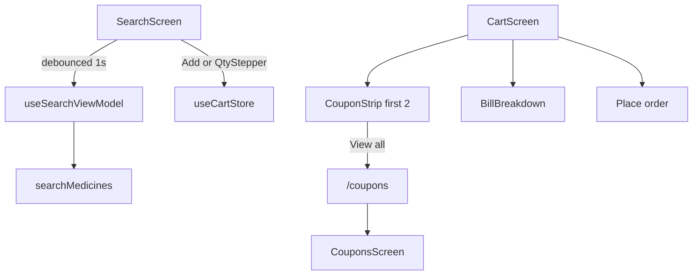

# UX Polish + Release Implementation Plan

> **For agentic workers:** REQUIRED SUB-SKILL: Use superpowers:subagent-driven-development (recommended) or superpowers:executing-plans to implement this plan task-by-task. Steps use checkbox (`- [ ]`) syntax for tracking.

**Goal:** Ship Home cart qty steppers, 1s search debounce, Blinkit-style coupons-above-bill with View-all stack screen, then README/NOTES, release APK, and push to `main`.

**Architecture:** Presentational `QtyStepper` in `common`. Search VM owns debounce timer + cart qty mutations. Coupons feature adds horizontal `CouponStrip` + `CouponsScreen`; Cart only reorders and navigates. No new packages. Location Settings path unchanged (blocked → Open Settings).

**Tech Stack:** Expo Router Stack, NativeWind, Zustand cart store, existing coupon tickets, local Gradle `assembleRelease`.

## Global Constraints

- Follow AGENTS.md layer rules; app imports feature `index.ts` only.
- No new npm deps (debounce = `setTimeout` + cleanup).
- One coupon at a time; reuse existing apply/toggle logic.
- Android API 33+; release APK via local native build (not Expo Go).
- Caveman stays for chat; code/commits/docs written normal prose.
- Commit after each task; final push `main` after APK + docs.

## File map

- Create: `docs/superpowers/specs/2026-10-31-ux-polish-design.md`
- Create: `src/common/components/QtyStepper.tsx` — shared − / count / +
- Create: `src/features/coupons/ui/components/CouponStrip.tsx` — first 2 horizontal + View all
- Create: `src/features/coupons/ui/screens/CouponsScreen.tsx` — vertical all coupons
- Create: `src/app/coupons.tsx` — thin route
- Create: `README.md` — install/run; deep detail → NOTES.md
- Create: `docs/superpowers/plans/2026-10-31-ux-polish.md` — copy of this plan
- Modify: `src/common/components/index.ts` — export QtyStepper
- Modify: `src/features/search/ui/viewmodels/useSearchViewModel.ts` — debounce + cart qty actions
- Modify: `src/features/search/ui/components/MedicineResultRow.tsx` — Add vs QtyStepper
- Modify: `src/features/search/ui/screens/SearchScreen.tsx` — wire qty handlers
- Modify: `src/features/cart/ui/components/CartLineRow.tsx` — use QtyStepper
- Modify: `src/features/cart/ui/screens/CartScreen.tsx` — strip then bill; View all
- Modify: `src/features/coupons/index.ts` — export strip + screen
- Modify: `src/app/_layout.tsx` — register `coupons` with header
- Modify: `NOTES.md` — How I Used AI skills; build section if needed



---

### Task 0: Persist approved design + plan files

**Files:**
- Create: `docs/superpowers/specs/2026-10-31-ux-polish-design.md`
- Create: `docs/superpowers/plans/2026-10-31-ux-polish.md`

- [ ] **Step 1:** Write design doc capturing approved §§1–3 (QtyStepper + 1s debounce; cart order lines→strip→bill→place; `/coupons` stack; location no-change; README/NOTES/APK/push).
- [ ] **Step 2:** Save this plan to `docs/superpowers/plans/2026-10-31-ux-polish.md`.
- [ ] **Step 3:** Commit `docs: add UX polish design and plan`.

---

### Task 1: Shared `QtyStepper`

**Files:**
- Create: `src/common/components/QtyStepper.tsx`
- Modify: `src/common/components/index.ts`
- Modify: `src/features/cart/ui/components/CartLineRow.tsx`

**Interfaces:**
- Produces: `QtyStepper({ qty, onIncrement, onDecrement, accessibilityName })`

- [ ] **Step 1:** Add presentational stepper (Pressables + count). Reuse cart a11y pattern: `Decrease ${name}` / `Increase ${name}`; `min-h-touch` / `min-w-[44px]`.

```tsx
export function QtyStepper({
  qty,
  onIncrement,
  onDecrement,
  accessibilityName,
}: {
  qty: number;
  onIncrement: () => void;
  onDecrement: () => void;
  accessibilityName: string;
}) {
  return (
    <View className="flex-row items-center gap-sm">
      <Pressable
        accessibilityRole="button"
        accessibilityLabel={`Decrease ${accessibilityName}`}
        className="min-h-touch min-w-[44px] items-center justify-center rounded-md bg-surface"
        onPress={onDecrement}
      >
        <AppText variant="title">−</AppText>
      </Pressable>
      <AppText variant="body">{qty}</AppText>
      <Pressable
        accessibilityRole="button"
        accessibilityLabel={`Increase ${accessibilityName}`}
        className="min-h-touch min-w-[44px] items-center justify-center rounded-md bg-surface"
        onPress={onIncrement}
      >
        <AppText variant="title">+</AppText>
      </Pressable>
    </View>
  );
}
```

- [ ] **Step 2:** Export from `src/common/components/index.ts`.
- [ ] **Step 3:** Replace inline ± in `CartLineRow` with `QtyStepper`; keep Remove button.
- [ ] **Step 4:** `npx tsc --noEmit` — expect clean for these files.
- [ ] **Step 5:** Commit `refactor: extract shared QtyStepper`.

---

### Task 2: Search debounce (1s) + Home qty UI

**Files:**
- Modify: `src/features/search/ui/viewmodels/useSearchViewModel.ts`
- Modify: `src/features/search/ui/components/MedicineResultRow.tsx`
- Modify: `src/features/search/ui/screens/SearchScreen.tsx`

**Patterns:**
- `setQuery` updates input only.
- `useEffect` on `query`: clear timer; empty → idle + clear results; else after **1000ms** call `executeSearch` (extract from current `runSearch`).
- `selectRecent` / `onSubmitEditing`: cancel timer and `executeSearch` immediately.
- Recents write stays inside `executeSearch` only (not every keystroke).
- Qty: subscribe `lines` from `useCartStore`; `qtyFor(id)`; expose `addToCart` / `increment` / `decrement` with toast on `!ok`.

**Interfaces:**
- Produces VM: `{ query, setQuery, status, results, recents, selectRecent, submitSearch, qtyFor, addToCart, increment, decrement }`
- `MedicineResultRow`: `qty: number`; if `qty === 0` show Add else `QtyStepper`

- [ ] **Step 1:** Refactor VM — split `executeSearch(raw)`; debounce effect; wire cart increment/decrement; `qtyFor`.

```ts
useEffect(() => {
  const trimmed = query.trim();
  if (!trimmed) {
    setStatus('idle');
    setResults([]);
    return;
  }
  setStatus('loading');
  const handle = setTimeout(() => {
    void executeSearch(query);
  }, 1000);
  return () => clearTimeout(handle);
}, [query, executeSearch]);
```

- [ ] **Step 2:** Update `MedicineResultRow` — Add vs `QtyStepper`.
- [ ] **Step 3:** Wire `SearchScreen` props from VM; `onSubmitEditing` → `submitSearch()`.
- [ ] **Step 4:** Manual check: type fast → one search after pause; add item → stepper; − to 0 removes.
- [ ] **Step 5:** `npx expo lint` + `npx tsc --noEmit`.
- [ ] **Step 6:** Commit `feat: debounce search and show cart qty on Home`.

---

### Task 3: CouponStrip + CouponsScreen + Cart reorder

**Files:**
- Create: `src/features/coupons/ui/components/CouponStrip.tsx`
- Create: `src/features/coupons/ui/screens/CouponsScreen.tsx`
- Modify: `src/features/coupons/ui/components/CouponList.tsx` (keep vertical; optional `title` prop default `Coupons`)
- Modify: `src/features/coupons/index.ts`
- Create: `src/app/coupons.tsx`
- Modify: `src/app/_layout.tsx`
- Modify: `src/features/cart/ui/screens/CartScreen.tsx`

**Interfaces:**
- `CouponStrip({ items, onToggle, onViewAll })` — `items.slice(0, 2)` in horizontal `ScrollView`; trailing View all Pressable.
- `CouponsScreen` — `useCartViewModel()` for `couponItems` / `toggleCoupon`; render `CouponList`.
- Cart order: lines → `CouponStrip` → `BillBreakdown` → Place order (empty cart: EmptyState only, no strip/bill needed or bill zeros — match current empty handling).

- [ ] **Step 1:** Implement `CouponStrip` (horizontal, first 2 tickets + View all).
- [ ] **Step 2:** Implement `CouponsScreen` + export from coupons `index.ts`.
- [ ] **Step 3:** `src/app/coupons.tsx` → `<CouponsScreen />`; root Stack:

```tsx
<Stack.Screen name="(tabs)" />
<Stack.Screen
  name="coupons"
  options={{ headerShown: true, title: 'All coupons', headerBackTitle: 'Cart' }}
/>
```

- [ ] **Step 4:** `CartScreen`: import `router` from `expo-router`; after lines, `CouponStrip` with `onViewAll={() => router.push('/coupons')}`; then `BillBreakdown`; then Place order. Remove old full `CouponList` from cart.
- [ ] **Step 5:** Verify apply on strip and on all-coupons screen updates bill; back keeps state.
- [ ] **Step 6:** lint + tsc.
- [ ] **Step 7:** Commit `feat: coupons strip and all-coupons screen`.

---

### Task 4: README + NOTES AI skills

**Files:**
- Create: `README.md`
- Modify: `NOTES.md` (How I Used AI + Build/run)

- [ ] **Step 1:** README — prerequisites (Node, Android device/emulator API 33+), `npm install`, `npx expo start`, `npx expo run:android`, lint/test, release APK path `dist/plazza-release.apk`, pointer: architecture and deep notes in `NOTES.md`.
- [ ] **Step 2:** Expand How I Used AI — name Cursor skills used as a professional workflow: `brainstorming` (design gate), `writing-plans` / `executing-plans` (or subagent-driven), `ponytail-senior-dev` (YAGNI + layer reuse), `caveman` (terse review voice), Expo docs via AGENTS.md. Keep factual; no fluff.
- [ ] **Step 3:** Commit `docs: README and AI workflow notes`.

---

### Task 5: Release APK + push main

**Files:**
- Output: `dist/plazza-release.apk` (copy from Gradle outputs)

- [ ] **Step 1:** Ensure native project: `npx expo prebuild -p android` if needed; `npx expo run:android --variant release` or `cd android && ./gradlew assembleRelease`.
- [ ] **Step 2:** Copy APK to `dist/plazza-release.apk`.
- [ ] **Step 3:** Confirm `git status` clean of secrets; APK may be gitignored — if ignored, note path in README only; do not force-add binaries unless already tracked.
- [ ] **Step 4:** Push commits to `main`: `git push -u origin HEAD` (or merge branch into main then push — use current branch policy: if on feature branch, merge/checkout main and push as user requested "push the commits to main").
- [ ] **Step 5:** Final verify: `npx expo lint`, `npx tsc --noEmit`, `npm test`.

---

## Spec coverage check

- Home qty when in cart — Task 2
- 1s search debounce — Task 2
- Coupons above bill, 2 scrollable + View all stack — Task 3
- Location Settings acceptable — documented in design Task 0; no code change
- README / NOTES AI skills — Task 4
- Release APK + push main — Task 5

## Out of scope

- EAS cloud build login, Rewards/categories, Expo Go MMKV, free-text coupon field
